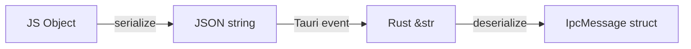
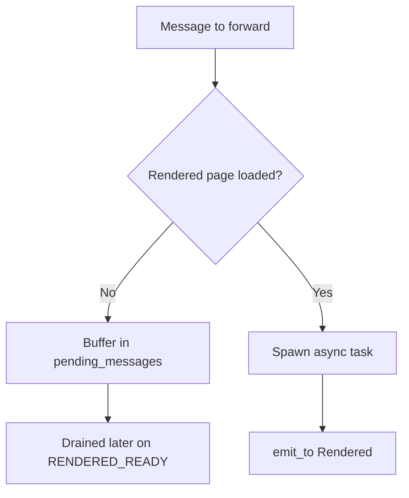
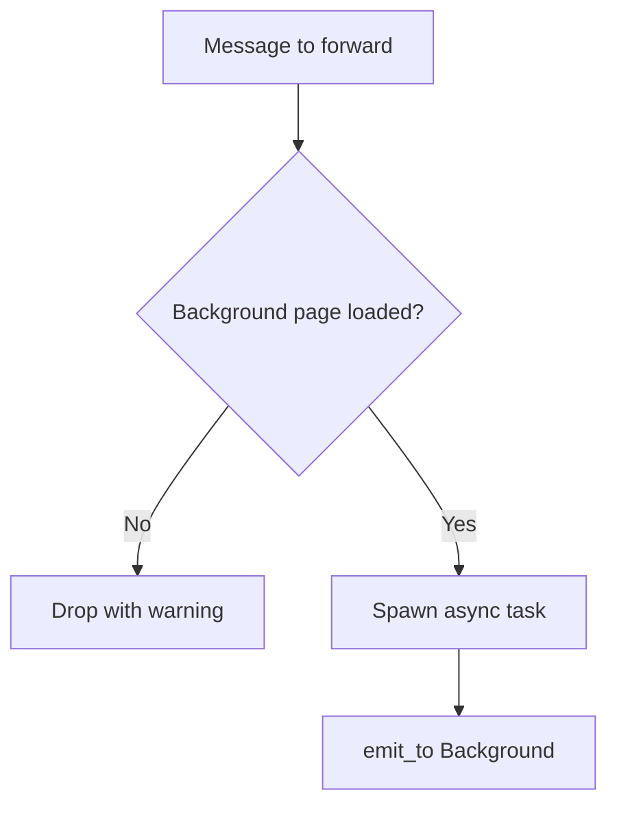
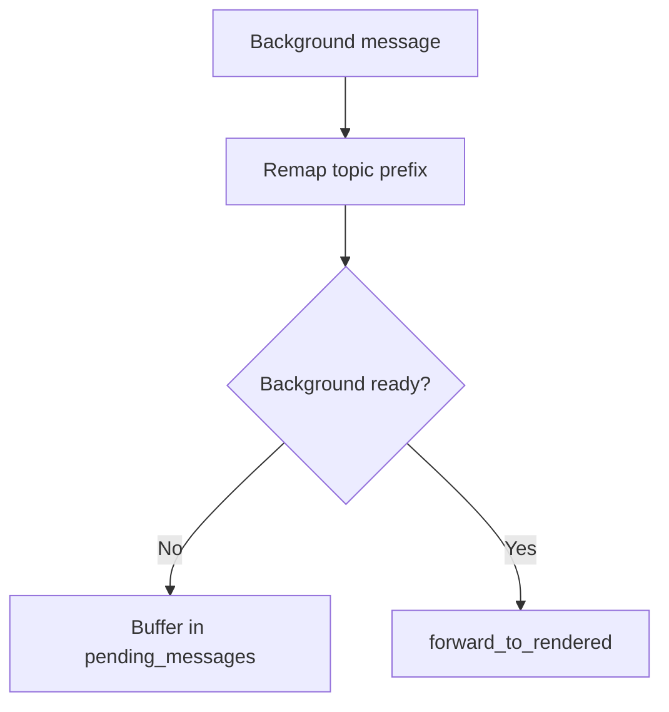

# IPC Layer

## Why IPC

The two webviews ([[03 - Webviews]]) are completely isolated from each other, they cannot communicate directly by design. This is the foundation of the security model: the Rendered side (visible to the user) must never be able to reach sensitive data in the Background side.

But the application still needs the two sides to exchange data. When the user opens a password, the Rendered webview needs to ask the Background to decrypt it. When the Background syncs resources from the API, it needs to push the update to the Rendered so the UI reflects it.

IPC (Inter-Process Communication) is the controlled channel that makes this possible. Every message passes through Rust, which validates it, decides whether to forward it, intercept it, or block it. Rust is the only bridge between the two webviews, and it enforces the rules at every step.

## Encryption

All IPC messages are encrypted with **AES-GCM** before reaching Tauri Core, thanks to the [[01- Isolation Pattern]]. A new key is generated at each app launch. This means messages cannot be read or tampered with in transit, even by compromised frontend code.

## Four Events

Defined in `config.rs`. Two events per webview: one for sending to Rust, one for receiving from Rust.


## Serialization

JS and Rust are two separate runtimes -- they cannot exchange objects directly. All IPC messages travel as **JSON strings**.

On the JS side, `tauriEmit('background-ipc-message', object)` looks like it sends an object, but Tauri serializes it to a JSON string under the hood before passing it to Rust. On the Rust side, `event.payload()` returns a `&str` which is then deserialized into a struct via `serde_json::from_str`.



This is transparent for the developer -- JS sends an object, Rust receives a struct -- but the transport is always a serialized string.

## Wire Format

File: `models/ipc_message.rs`

```rust
pub struct IpcMessage {
    pub topic: String,                         
    pub status: Option<String>,                
    pub message: Option<serde_json::Value>,    // JSON payload
    #[serde(alias = "requestId", rename = "requestId")]
    pub request_id: Option<String>,            // UUID v4 for correlation
    #[serde(rename = "withMultipleParam")]
    pub with_multiple_param: bool,
}
```

Three constructors: `new(topic, message)`, `success(request_id, message)`, `error(request_id, message)`.

## Listener Registration

File: `services/ipc_listener_service.rs` (61 lines)

`setup(app)` registers two listeners on the Tauri app:

```rust
app.listen(RENDERED_IPC_MESSAGE, |event| {
    let ipc = parse_ipc_payload(event.payload());  // -> Option<Result<IpcMessage>>
    rendered_service.handle(app, state, ipc);
});

app.listen(BACKGROUND_IPC_MESSAGE, |event| {
    let ipc = parse_ipc_payload(event.payload());
    background_service.handle(app, state, ipc);
});
```

`parse_ipc_payload()` returns `None` for null/empty payloads (JS sometimes emits without data).

## Forwarding Functions

File: `services/topics/handlers.rs`

### `forward_to_rendered(app, ipc)`

1. Check `navigation.is_rendered_page_loaded()`
2. If false -> buffer in `ipc.push_pending_message(ipc)` (message will be drained on RENDERED_READY)
3. If true -> `tauri::async_runtime::spawn()` + `app.emit_to(RENDERED_WEBVIEW_LABEL, RENDERED_IPC_FORWARD, ipc)`

The `emit_to()` is spawned in an async task to avoid blocking the event loop.



### `forward_to_background(app, ipc)`

1. Check `navigation.is_background_page_loaded()`
2. If false -> **drop with warning** (no buffer for Background -- it's rare and recoverable)
3. If true -> spawn async + `emit_to(BACKGROUND_WEBVIEW_LABEL, BACKGROUND_IPC_FORWARD, ipc)`



### `buffer_or_forward_to_rendered(app, state, ipc)`

Used for unsolicited Background -> Rendered messages (localStorage sync):
1. Check `navigation.is_background_ready()`
2. Remap topic: `background.localstorage-update` -> `rendered.localstorage-update`
3. If not ready -> buffer
4. If ready -> call `forward_to_rendered()`



### `navigate_webview(app, label, url)`

Calls `app.get_webview_window(label).navigate(url)`.

## JS Side (IPCHandler)

File: `apps/background-webview/src/shared/IPCHandler.js`

**Background**: singleton (`IPCHandler.getInstance()`). Listens on `background-ipc-forward`, emits on `background-ipc-message`.

**Rendered**: per-instance. Listens on `rendered-ipc-forward`, emits on `rendered-ipc-message`.

Key methods:
- `on(name, callback)` -- persistent listener
- `once(name, callback)` -- one-shot listener
- `emit(topic, [status], [message])` -- fire-and-forget
- `request(topic, ...args)` -- returns Promise, generates UUID requestId, registers one-shot listener on that ID

Request concurrency: `_maxConcurrentRequests = 1`. Queued via Promise. 1-second timeout auto-releases the slot.

On init, Background emits `passbolt.background.listener-ready` to signal Rust that the event system is wired.

## Debug Instrumentation

File: `services/topics/handlers.rs:19-45`

In debug builds, a `diag` module tracks:
- Sequence numbers (atomic counter)
- Timestamps (ms since start)
- Thread IDs

This is compiled out in release (`#[cfg(debug_assertions)]`).
