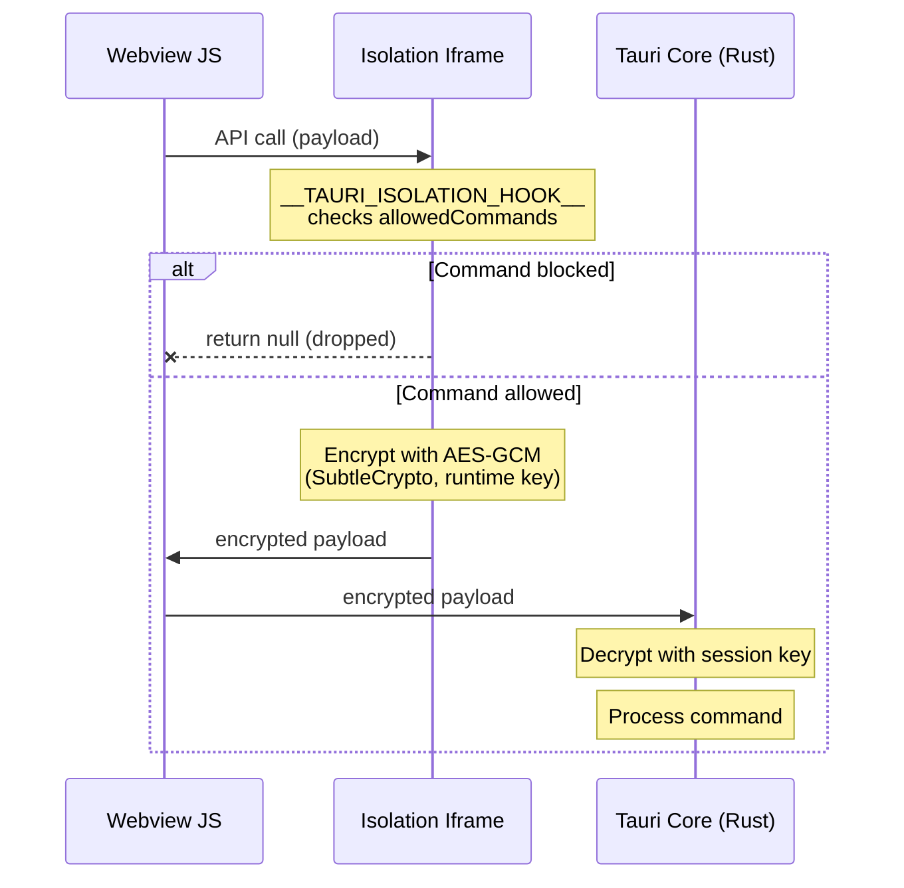

## What It Is

The isolation pattern is a Tauri security feature that places a **sandboxed iframe** between the frontend JavaScript and Tauri Core (Rust). Every call from a webview to the Tauri API must pass through this iframe before reaching Rust. The iframe can inspect, modify, or block any call.

Without isolation, any JavaScript running in the webview -- including code from third-party dependencies -- can call the Tauri API directly. With isolation, a developer-controlled gate sits in the middle.

## What Problem It Solves

The frontend bundles dozens of dependencies (React, passbolt-browser-extension, openpgp, styleguide, and all their transitive dependencies). Any one of these could be compromised -- through a supply chain attack, a malicious update, or a vulnerability. If a compromised dependency can call any Tauri API, it could:

- Execute shell commands on the user's machine
- Read or write files
- Make HTTP requests to arbitrary domains
- Access plugins the app didn't intend to expose

The isolation pattern prevents this. Even if a dependency is compromised, it can only call what the isolation hook explicitly allows.

## How It Works

### The Iframe Sandbox

When the app loads, Tauri injects an `<iframe>` with a unique origin (e.g., `isolation-abcd1234://localhost`). This iframe runs in a separate JavaScript context -- the frontend cannot access its contents or modify its code.

All Tauri API calls from the webview are routed through this iframe. The iframe exposes a single hook function: `__TAURI_ISOLATION_HOOK__`. This function receives the payload of every call and decides what to do with it.

### Our Implementation

File: `src/isolation/index.js`

```javascript
window.__TAURI_ISOLATION_HOOK__ = (payload) => {
    try {
        const allowedCommands = [
            'plugin:event|emit',
            'plugin:event|listen',
            'plugin:event|unlisten',
        ];
        if (!allowedCommands.includes(payload.cmd)) {
            console.error('Isolation: Blocked command:', payload.cmd);
            return null;
        }

        //@todo check if the message is allowed
        //@todo check if the message is valid
        //@todo check the sender

        return payload;
    } catch (error) {
        console.log(error)
    }
}
```

### What Passes Through

Only three commands are allowed:

| Command | Purpose |
|---------|---------|
| `plugin:event\|emit` | Send an event to Rust |
| `plugin:event\|listen` | Register an event listener |
| `plugin:event\|unlisten` | Remove an event listener |

These are the only operations the webviews need. The entire [[04 - IPC Layer]] runs on events.

### What Is Blocked

Everything else returns `null` and is silently dropped. This includes:

- `tauri::invoke` -- direct Rust function calls
- `plugin:shell|*` -- shell command execution
- `plugin:fs|*` -- filesystem access
- `plugin:http|*` -- direct HTTP requests
- `plugin:dialog|*` -- file pickers, system dialogs
- `plugin:process|*` -- process management
- Any other Tauri plugin command

## Encryption

After the hook runs, the message is **encrypted with AES-GCM** before leaving the isolation iframe.



Key properties:
- Encryption uses the browser's **SubtleCrypto** API (AES-GCM, authenticated encryption)
- A new **cryptographically secure key is generated at each app launch** -- keys cannot be reused across sessions
- Even if an attacker can intercept the encrypted message, they cannot read or tamper with it without the session key

This means a compromised script cannot forge IPC messages by crafting them manually and sending them to Tauri Core. The messages must pass through the isolation iframe to be encrypted with the correct key.

## Configuration

File: `src-tauri/tauri.conf.json`

```json
{
    "app": {
        "security": {
            "pattern": {
                "use": "isolation",
                "options": {
                    "dir": "../src/isolation"
                }
            }
        }
    }
}
```

The `dir` points to the folder containing `index.html` and the hook script. Tauri loads this at build time and inlines the scripts (because sandboxed iframes on Windows don't load external files correctly).

## Planned Improvements

The current implementation has three TODOs marked in the code:

```javascript
//@todo check if the message is allowed
//@todo check if the message is valid
//@todo check the sender
```

These would add deeper validation beyond the command whitelist:
- **Message validation**: verify the payload structure matches what's expected for each command
- **Sender checking**: verify which webview sent the message (Rendered vs Background)

Currently, these checks happen further down the chain in Rust (topic whitelist, requestId validation). The TODOs represent an opportunity to add an earlier layer of defense in the isolation iframe itself.

## Relationship to Other Security Layers

The isolation pattern is one layer in the defense-in-depth model (see [[09 - Security Layers]]):

- **Isolation iframe** filters which Tauri commands can be called + encrypts the IPC channel
- **CSP** controls which resources each webview can load
- **Topic whitelist** validates which IPC topics are accepted by Rust
- **Navigation guards** restrict which URLs each webview can navigate to
- **Platform hardening** disables browser features (DevTools, context menu, zoom)

Each layer protects against a different class of attack. The isolation pattern specifically targets **compromised frontend dependencies** -- the most likely threat vector for a desktop app that bundles third-party JavaScript.
